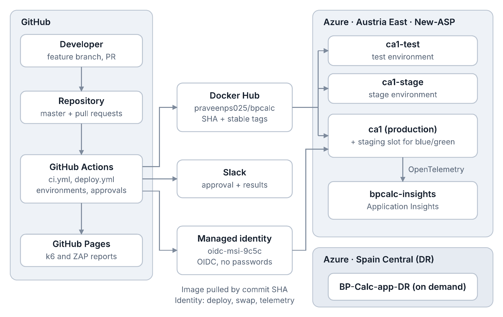
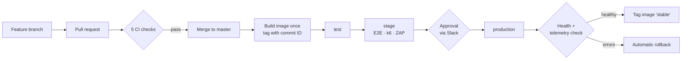
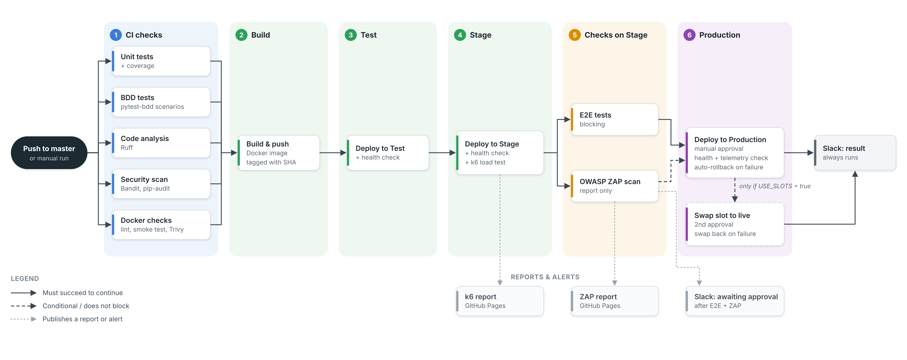
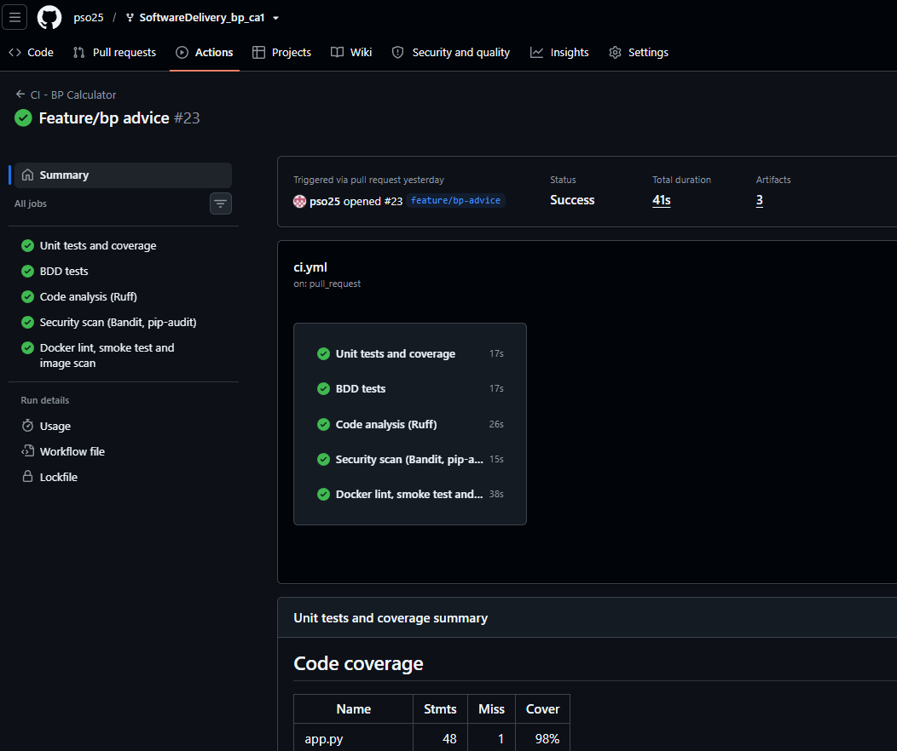
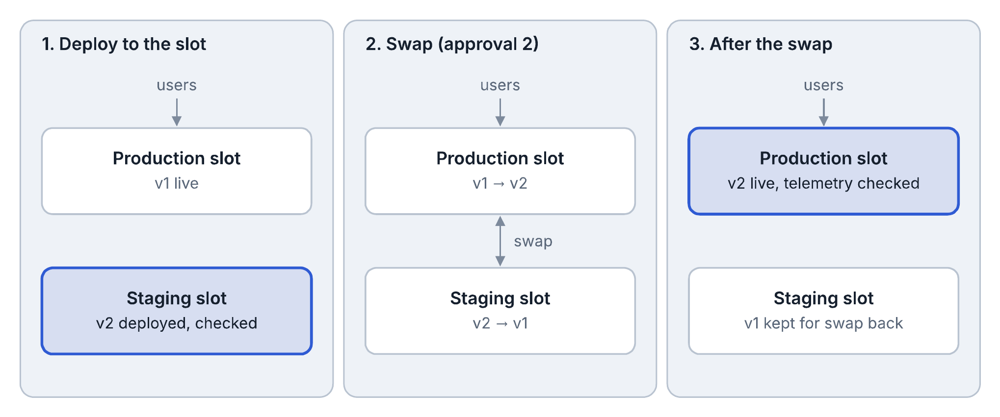
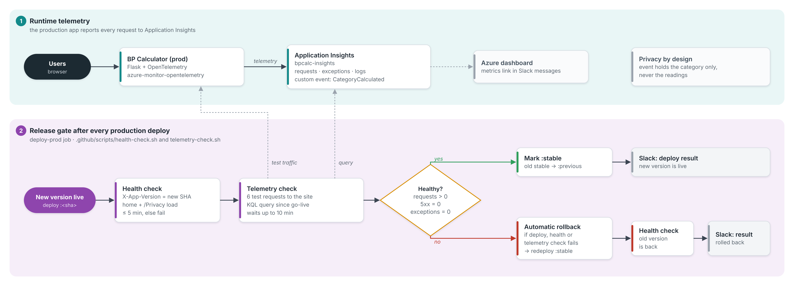
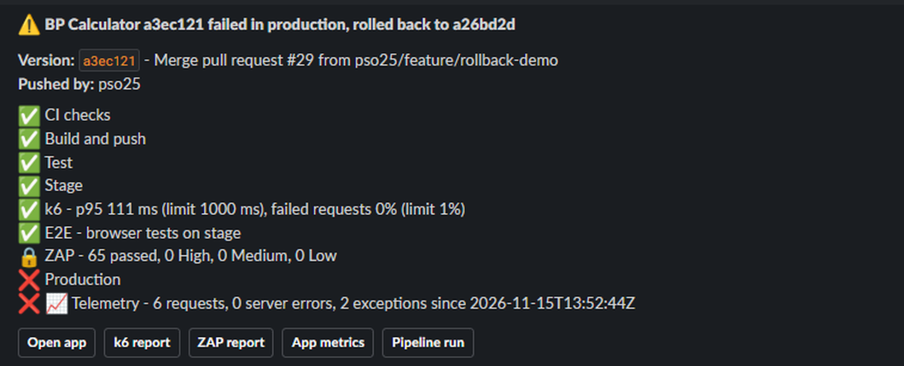
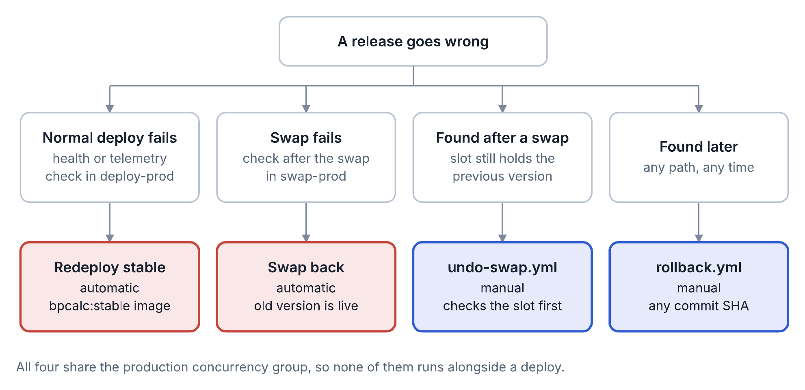
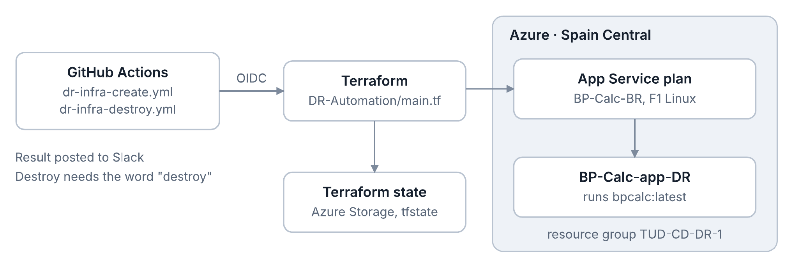

# CI/CD Pipeline with Automatic Rollback: Blood Pressure Calculator

A complete continuous delivery pipeline for a small Python (Flask) web app, built with **GitHub Actions**, **Docker** and **Azure App Service**. Every change goes from a feature branch through automated checks, three environments and an approval gate to production. If production looks unhealthy after a release, the pipeline **rolls back on its own**.

Built for the *Continuous Software Deployment* module of the MSc in Computing (DevOps) at TU Dublin.

| 96% | 84 + 21 | 110 ms | 0 | 28 |
|:---:|:---:|:---:|:---:|:---:|
| test coverage | unit + BDD tests | p95 under load (k6) | ZAP high/medium/low alerts | pull requests shipped |

---

## Architecture

- **GitHub** holds the code. **GitHub Actions** runs every check and deployment.
- **Docker Hub** stores the image. It is built once per change and tagged with the commit ID.
- **Azure App Service** (Austria East, one App Service plan) runs the same image in three web apps: `ca1-test`, `ca1-stage` and `ca1` (production, with a staging slot for blue/green).
- **Application Insights** receives telemetry from production through OpenTelemetry.
- **Slack** posts results, approval requests and rollbacks.
- **GitHub Pages** publishes the k6 and ZAP reports.
- **Disaster recovery:** a copy of the site in **Spain Central** exists only when it's created with Terraform.

| Environment | Azure app | Purpose | Must pass to move on |
|---|---|---|---|
| test | `ca1-test` | First place a new version goes | Health check |
| stage | `ca1-stage` | Production-like copy where the heavy tests run | Health check, E2E tests, k6 limits |
| production | `ca1` (+ staging slot) | The live site | Approval, health check, telemetry check |
| DR (on demand) | `BP-Calc-app-DR` | Backup copy in another region | Approval |

## How a change reaches production

| Stage | What runs | Fails the build if |
|---|---|---|
| **Pull request (CI)** | pytest + coverage, pytest-bdd, Ruff, Bandit, pip-audit, Hadolint, container smoke test, Trivy | A test fails, coverage drops below 80%, the container doesn't start, or the image has a critical fixable vulnerability |
| **test** | Deploy the image, then run a health check | The new version doesn't come up healthy |
| **stage** | Playwright E2E (9 tests), k6 load test, OWASP ZAP scan | p95 > 1 s, > 1% failed requests, < 99% checks passing, or E2E failures. ZAP reports for a human to review |
| **Approval** | Results posted to Slack; a reviewer approves in GitHub | Nobody approves |
| **production** | Deploy, health check, telemetry check | Server errors or exceptions appear in Application Insights, which triggers an automatic rollback |

### Branching
Every change starts on a short-lived feature branch and is merged to `master` through a pull request, but only after all five CI checks pass. Merging to `master` starts a deployment. 28 pull requests went through this flow.

### Build once, promote unchanged
The image is built once, tagged with the commit ID, and that exact image moves from test to stage to production. Nothing is rebuilt along the way. When a release passes in production, the image is tagged `stable` and the one it replaced is tagged `previous`, so a rollback always has a known-good target.

### Health checks that can't pass by accident
Azure keeps the old container running while the new one starts. The health check therefore waits until the site reports the **new commit ID** in an `X-App-Version` header, and only then checks that the pages load. The version is also shown on the page, so anyone can see what's live.

## Releasing to production

Production has two release modes, controlled by the `USE_SLOTS` environment variable:

- **Direct (default):** the new version goes onto the live site and is rolled back automatically if its checks fail.
- **Blue/green:** the new version goes into a staging slot, is checked, and goes live with an approved **slot swap**. The old version stays in the slot so the swap can be reversed. Slots need the Standard tier or higher, so this mode was demonstrated on Premium V3 and then switched off to save credit.

## The release gate and automatic rollback

After go-live, the pipeline sends test requests and polls Application Insights every 30 seconds, for up to 10 minutes, for server errors and exceptions. If it finds any, or no data arrives, it puts the `stable` image back by itself.

**Tested for real:** PR #29 shipped a deliberate fault that only shows up in production. It passed CI, test and stage and was approved, but the telemetry check found 2 exceptions after go-live. The pipeline rolled back to the `stable` image automatically and reported it in Slack:

## Recovery options

| Problem | Recovery | How |
|---|---|---|
| Normal deploy fails its checks | Redeploy the `stable` image | Automatic |
| Blue/green swap fails its checks | Swap back | Automatic |
| Problem found later, after a swap | `undo-swap.yml` | Manual, with approval |
| Problem found later, any path | `rollback.yml` to `stable` or any earlier commit | Manual, with approval |

All recovery workflows share the production concurrency group, so none of them can run at the same time as a deploy.

## Disaster recovery

A GitHub Actions workflow runs **Terraform** to build a full copy of the site in a second Azure region (Spain Central), with state stored in Azure Storage. A destroy workflow removes it again (you must type `destroy` to confirm), so it costs nothing when not needed. Both need approval.

## Monitoring

- **OpenTelemetry → Application Insights:** requests, errors, logs and a custom `CategoryCalculated` event.
- **Privacy by design:** the event stores only the blood pressure **category**, never the readings. Telemetry is off unless the Azure connection string is set, so tests and local runs send nothing.
- **Azure dashboard** for CPU, response time and requests.

## Security

- **Keyless login to Azure with OIDC** for production jobs: no stored password, and Azure only trusts tokens from the production environment.
- Checks at every stage: Ruff and Bandit for code, pip-audit for packages, Hadolint and Trivy for the container, OWASP ZAP against the running site.
- **Problems the pipeline found and fixed:** missing security headers (CSP, HSTS, secure cookies), outdated jQuery libraries flagged by ZAP, health-data pages that could be cached, and a wrong error message caught by the E2E tests.

## The application

- Rebuilt from the original ASP.NET Core starter app in **Python (Flask)**, keeping the same pages, form fields and error messages, so one test runner covers every CI requirement.
- **Category rules:** High (systolic ≥ 140 or diastolic ≥ 90), Pre-High (≥ 120 / ≥ 80), Ideal (≥ 90 / ≥ 60), otherwise Low. The higher reading decides.
- **New feature:** health advice for each category, built test-first on `feature/bp-advice` (16 lines of code) and shipped through the full pipeline.

## Tech stack

| Area | Tools |
|---|---|
| CI/CD | GitHub Actions, GitHub Environments, Docker Hub |
| App | Python, Flask |
| Hosting | Azure App Service (deployment slots) |
| Testing | pytest, pytest-cov, pytest-bdd, Playwright, k6 |
| Security | Ruff, Bandit, pip-audit, Hadolint, Trivy, OWASP ZAP, OIDC |
| Monitoring | OpenTelemetry, Azure Application Insights, Slack |
| Infrastructure as code | Terraform |

## Repository layout

| Path | Contents |
|---|---|
| `.github/workflows/` | CI checks, build-and-deploy pipeline, rollback, undo swap and disaster recovery workflows |
| `BPCalculator_Python/` | The Flask app and its tests |
| `DR-Automation/` | Terraform for the disaster recovery site |
| `BPCalculator/` | The original ASP.NET Core starter app |
| `docs/images/` | Diagrams and screenshots used in this README |

## Limitations and next steps

| Limitation | Next step |
|---|---|
| The image is built twice (once for scanning, once for release) | Scan and push the same image |
| ZAP reports but doesn't block | Block on high alerts |
| Blue/green is off by default (slots need a paid tier) | Keep the plan on Standard or higher |
| Automatic rollback only covers the ~10-minute release window | Azure Monitor alert on server errors plus a scheduled health check to Slack |
| Trivy doesn't block high-severity issues | Upgrade affected packages and fail on fixable highs |
| The container runs as root | Add a non-root user to the Dockerfile |
| Test and stage use publish profiles | Move every environment to OIDC |
